# InfiniteSpace

A visual thinking and planning workspace on an infinite canvas. Create named workspaces, organize ideas with sticky notes, text cards, images, link cards, and groups, connect them with curved, labelled arrows, and return to everything exactly as you left it. Your work is saved automatically in the browser.

## Built with


## Screenshots

Captured from the running production build. Every workspace, card, and connection shown was created through the UI. The two pictures on the canvas are generated gradients, not photographs.

| Dashboard (dark) | Dashboard (light) |
| --- | --- |
| 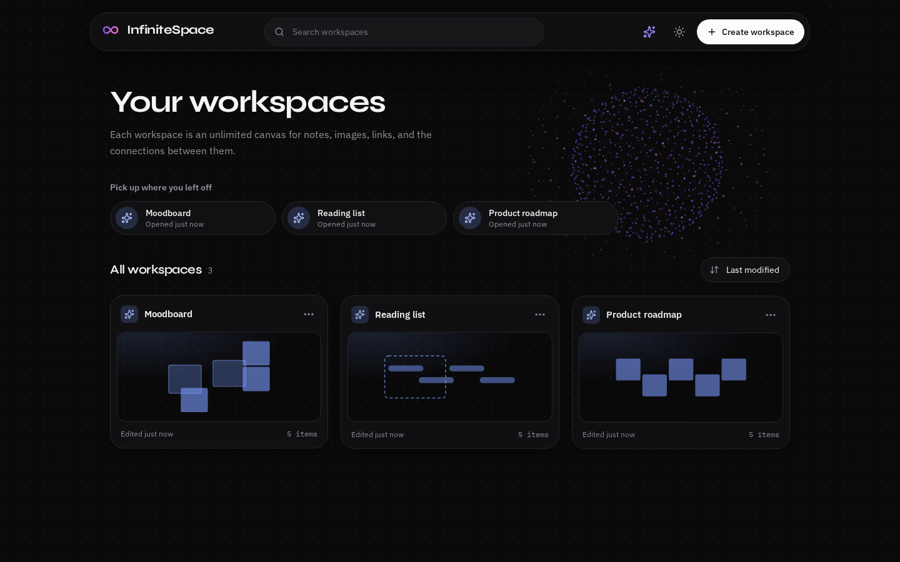 | 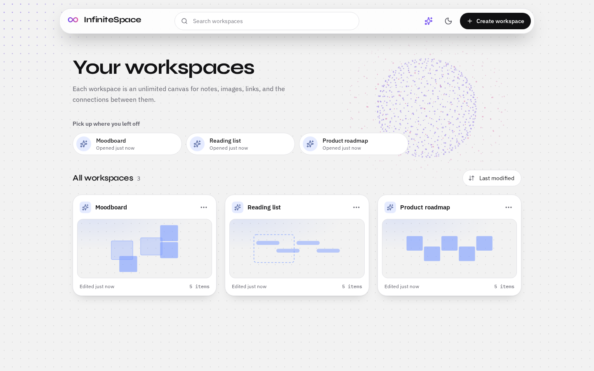 |

| Canvas (dark) | Canvas (light) |
| --- | --- |
| 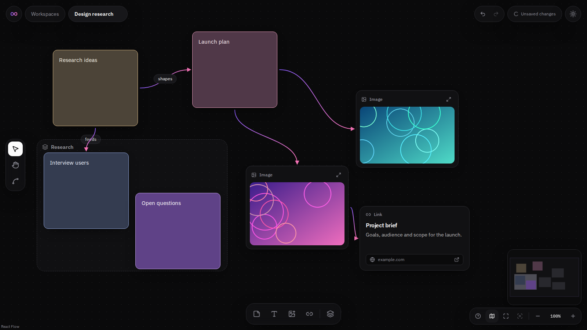 | 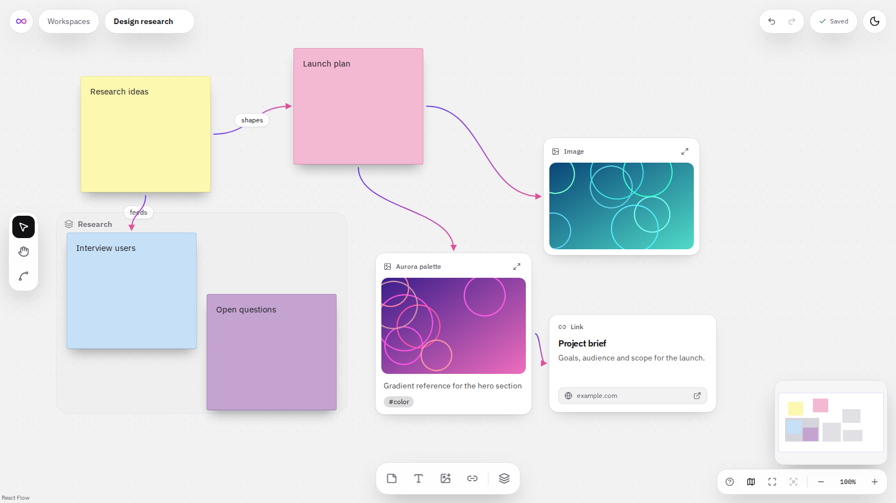 |

| Image properties | Connection properties |
| --- | --- |
| 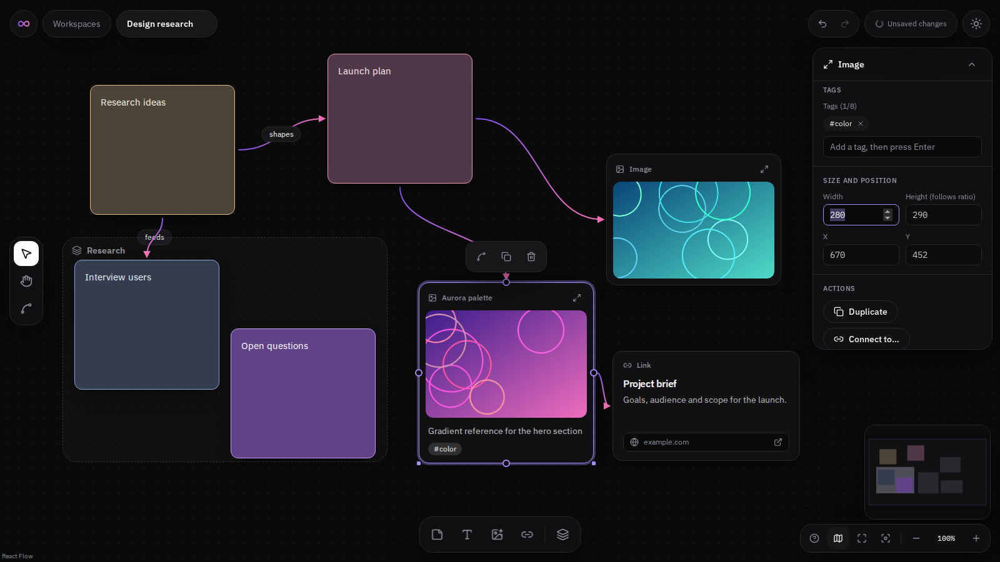 | 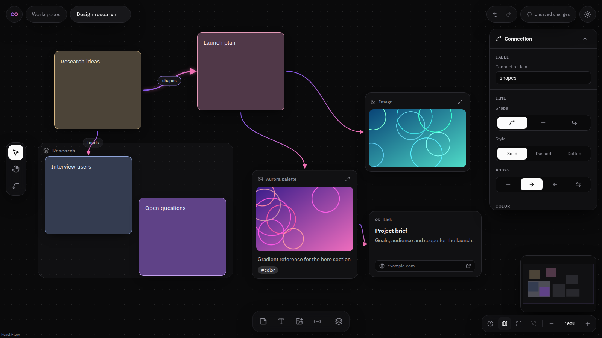 |

| A failed save: the work stays on screen and Retry is offered | Keyboard focus: Tab reaches cards and shows a ring |
| --- | --- |
| 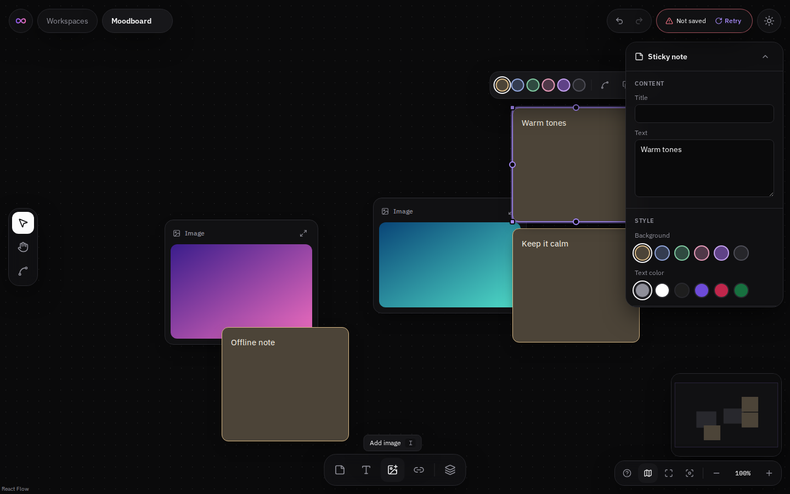 | 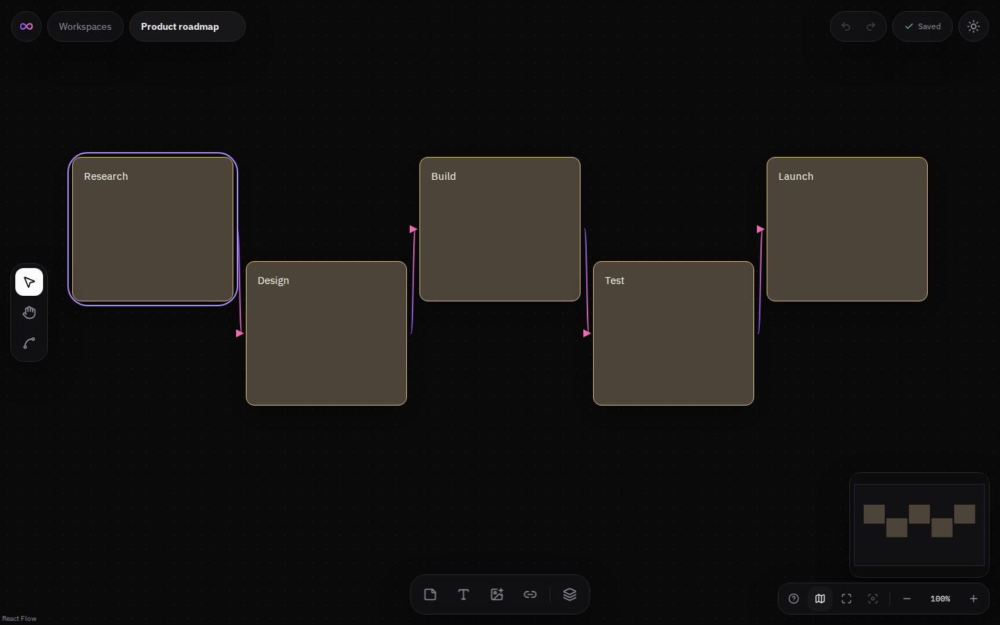 |

| Tablet dashboard (768 px) | Tablet editor (768 px) |
| --- | --- |
| 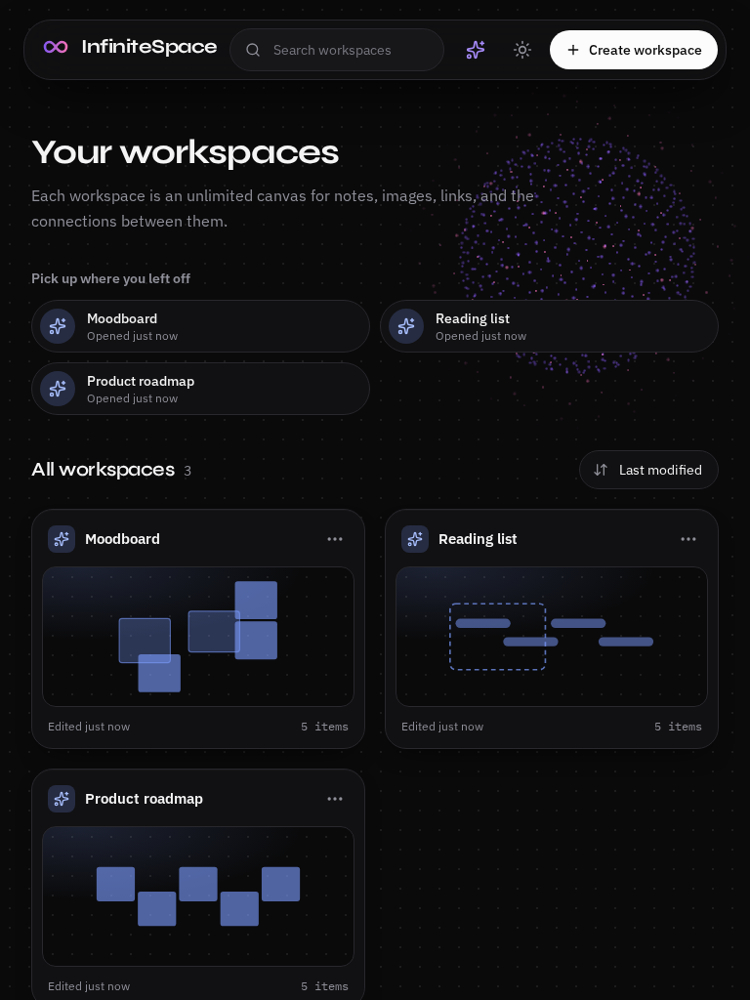 | 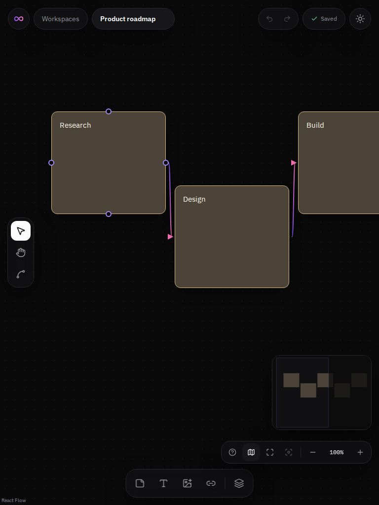 |

| Right-click menu | Outline and focus on a branch | Read-only HTML page |
| --- | --- | --- |
| 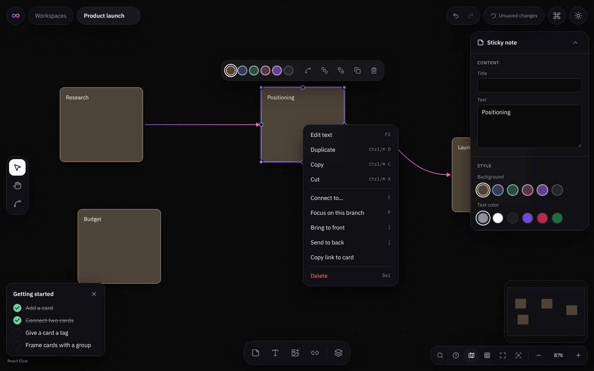 | 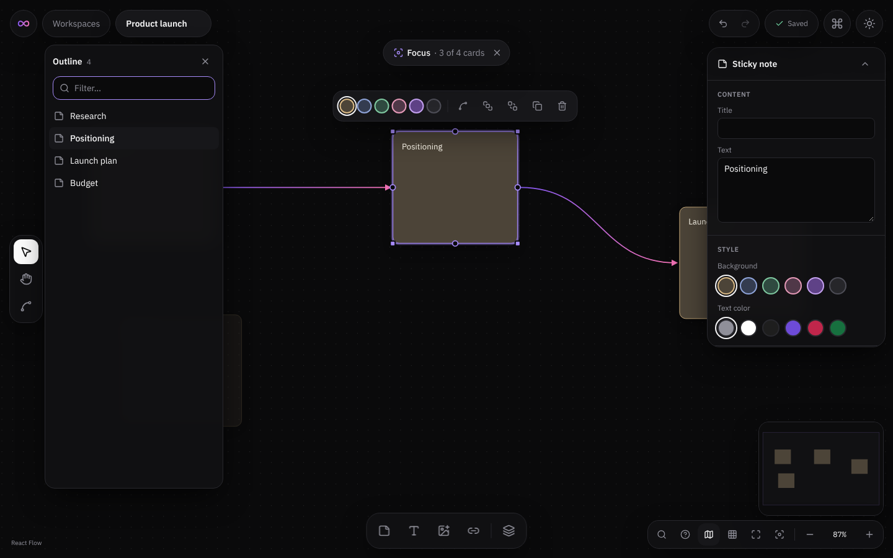 | 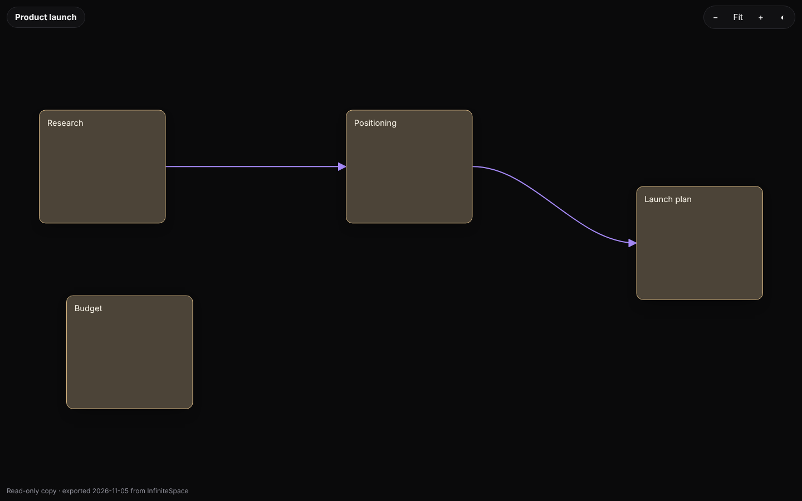 |

| Create workspace | Canvas on a phone | Dashboard on a phone |
| --- | --- | --- |
| 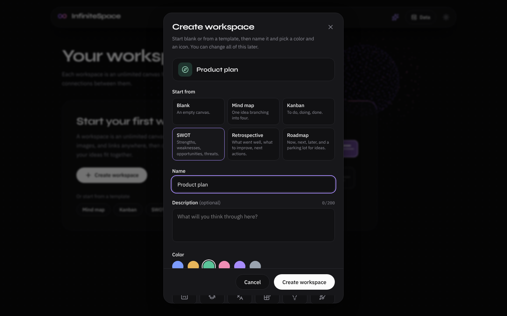 | 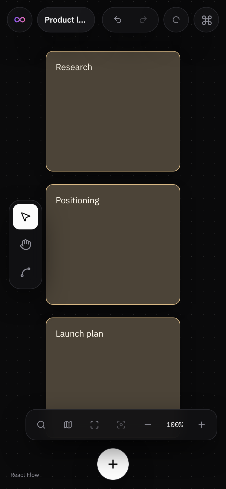 | 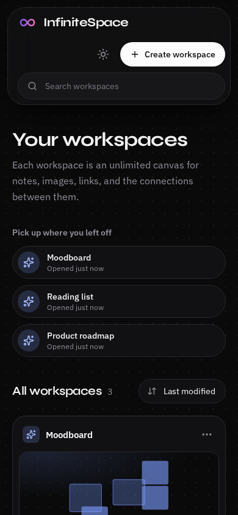 |

## About the project

### What it is

InfiniteSpace is a frontend-only, local-first web app. A dashboard lists your workspaces; opening one shows a full-screen canvas you can pan and zoom without limits. There is no backend, no account, and no network request from the app's own code: workspace metadata lives in `localStorage`, and canvases and images live in IndexedDB. The look follows dark whiteboard tools: floating pill-shaped bars, a left tool rail, a bottom creation dock, and a properties panel, in dark and light themes.

### Key features

- **Dashboard:** create, rename, recolor, duplicate, and delete workspaces; search and sort; a live preview and item count on every card.
- **Canvas:** pan, zoom, fit all, zoom to selection, optional minimap; sticky notes (eight colors), text cards with light Markdown, image cards (card, sticker, or cover look), link cards, checklists, shapes, YouTube video cards (nothing loads until you press play), a status ring and locking on cards, tags, and dashed group frames that carry their cards.
- **Connections:** curved, straight, or stepped lines; solid, dashed, or dotted; arrows at either end; gradient or solid colors; optional labels.
- **Images:** add from the dock, drag files in, or paste; PNG, JPEG, WebP, GIF, and AVIF with size and pixel limits; resizing never distorts a picture. Large pictures are scaled down and stored as WebP to save space (animated ones are left alone, and the command palette can turn this off).
- **Arranging:** copy, cut, and paste cards (also between workspaces), reattach a connection by dragging its end, align and distribute a selection, arrange it as a tree or in columns by status, see where a card goes and comes from, change layers, snap to the grid, and find cards by text or tag.
- **Present and start fast:** press `P` to present: every group becomes a slide and the camera flies from one to the next. The Create workspace dialog starts blank or from a template (mind map, Kanban, SWOT, retrospective, roadmap).
- **Fast creation:** drag a connection dot onto empty canvas to create a new connected card; paste a web address or text to turn it into link and note cards; press `Ctrl/⌘+K` for a command palette (every action, plus jumping to another workspace); click a tag on a card to fade every card without it.
- **Navigate and share:** a right-click menu (long-press on touch), a focus mode that fades everything unrelated to the selected card (`F`), an outline list of groups and cards (`O`), group titles that stay readable when zoomed far out, links that open a workspace at a card, a search box on the dashboard that finds cards inside all workspaces, personal snippets to reuse selections, and a one-file read-only HTML copy of a workspace that opens offline.
- **Comfort:** dark, light, follow-the-system and high-contrast themes; a getting-started list on a new canvas; a command palette button for touch screens.
- **Safe saving:** automatic saving with a visible status, a retry when storage refuses a write, restore of the exact view after a reload, and undo/redo (up to 100 steps).
- **Resilient data:** everything read from storage is validated; damaged items are skipped, and unreadable canvases are backed up before anything is overwritten.
- **Data safety:** export a workspace to a file and import it back, restore or download recovery copies, see how full browser storage is, and get a warning (with a choice of version) when two tabs edit the same workspace. A rendering error shows a recovery page instead of a blank screen.
- **Accessibility and comfort:** keyboard operation, skip link, labelled controls, reduced-motion support, 44 px touch targets, layouts checked from 390 px to 1440 px.
- **Scale:** workspaces hold up to 5,000 items and 10,000 connections; only visible cards are rendered.
- **Offline and backup:** installable, works offline after the first visit (a service worker), asks before applying an update; a backup reminder, and backups to a folder you choose (Chromium) or as downloaded files.
- **Polish:** restrained motion (Web Animations on the dashboard, GSAP in the editor), a Magic UI-style card spotlight, and an optional Three.js dashboard backdrop that can be turned off.

### Getting started

Prerequisites: Node.js `^20.19.0` or `>=22.12.0`, and npm. No environment variables are needed.

```bash
npm install
npm run dev        # http://localhost:5173
```

| Command | What it does |
| --- | --- |
| `npm run dev` | Start the Vite dev server |
| `npm run build` | Type-check (`tsc -b`), then build to `dist/` |
| `npm run preview` | Serve the production build locally |
| `npm run typecheck` | TypeScript project check |
| `npm run lint` | ESLint |
| `npm test` | Run the unit tests once (`npm run test` is the same command) |
| `npm run test:watch` | Run the unit tests in watch mode |
| `npm run docs:check` | Check Markdown line limits, links, and the README structure |
| `npm run deploy:check` | After a build: check `vercel.json` and `dist/` for a Vercel deployment |

Browser flows are Python Playwright scripts in `e2e/`; see [docs/TESTING.md](docs/TESTING.md) for how to run them. The build is a static single-page app: configure the host to serve `index.html` for unknown paths so `/w/<id>` survives a refresh.

### Project structure

```
src/
  app/                 Router and app shell
  components/          Shared UI primitives and layout visuals
  features/
    workspaces/        Dashboard, workspace forms, search and sort, background effect
    canvas/            Editor: nodes, edges, properties panel, persistence, uploads
  stores/              Zustand stores (workspaces, UI preferences, one canvas store per editor)
  services/persistence/  Storage adapters (localStorage metadata, IndexedDB canvases and images)
  services/transfer/   Workspace export and import, recovery copies
  hooks/  lib/  styles/
e2e/                   Playwright flows (Python)
docs/                  Detailed documentation and screenshots
.claude/  CLAUDE.md    Claude Code setup
```

### Documentation

| Document | Contents |
| --- | --- |
| [docs/FEATURES.md](docs/FEATURES.md) | Visual direction, implementation status by phase, everything that works today, keyboard shortcuts |
| [docs/FEATURES-PHASE-18.md](docs/FEATURES-PHASE-18.md) | Status ring, locking, checklists, shapes, Markdown, YouTube cards, links panel, tree and column layouts |
| [docs/ARCHITECTURE.md](docs/ARCHITECTURE.md) | Technology and version decisions, code layout, key design decisions, deployment |
| [docs/SECURITY.md](docs/SECURITY.md) | How links, images, text, and stored data are handled |
| [docs/TESTING.md](docs/TESTING.md) | Unit tests, browser flows, the Definition of Done evidence, load test, what was not verified |
| [docs/LIMITATIONS.md](docs/LIMITATIONS.md) | Known limitations |
| [docs/DEPLOYMENT.md](docs/DEPLOYMENT.md) | Deploying to Vercel, headers, and the first-deployment checklist |
| [features.md](features.md) | Roadmap for phases 7 to 16, with a ✅ on every implemented feature |
| [docs/CLAUDE-CODE.md](docs/CLAUDE-CODE.md) | The Claude Code setup: rules, agents, hooks, and the `/verify`, `/review`, `/new-feature`, `/fix-issue` workflows |

### Status

The six build phases are complete (dashboard, canvas, relationships, saving and history, polish and accessibility, final verification). Phase 7 (data safety), most of Phase 8 (copy and paste, reattaching connections, align, distribute, snap, find, layers), the five quick wins of Phase 11, presentation mode and the template gallery (Phase 12), the UX fixes of Phase 15, and most of Phase 16 (right-click menu, focus branch, deep links, outline, semantic zoom, read-only HTML page, search in all workspaces, snippets) are implemented. 816 unit tests and the browser flows in headless Chromium cover them (see [docs/TESTING.md](docs/TESTING.md) for each flow's checks). Reading the code and running the app at phone size also corrected an earlier claim: the minimap was already hidden on phones; the real problem was a two-row zoom toolbar. Shape cards and snapshots from Phase 16 are not built. The deployment to Vercel has not been tried, and only Chromium was used. Data stays in one browser profile, so export a workspace to keep a copy. Phase 18 added cards and tools inspired by Kinopio, Scrintal, and Miro (status ring, locking, checklists, shapes, Markdown, video cards, links panel, tree and column layouts); PNG/SVG and slide-deck export are not done yet.

## Future additions

Not implemented yet, by priority. The full roadmap with status marks is in [features.md](features.md).

**1. Canvas productivity (rest of Phase 8)**

- Guide lines while dragging and locking a card.
- Export of the canvas as an image, and a level-of-detail mode so very large canvases stay smooth when zoomed far out.

**2. Arabic, right-to-left, and offline (Phase 9)**

- An Arabic, right-to-left interface with an Arabic web font and logical CSS properties.
- Done already: installable offline use (PWA). Still missing: the Arabic dictionary and font.

**3. Quality and tooling (Phase 10)**

- Confirm the CI workflow (`.github/workflows/ci.yml`) on GitHub; it is written but has not run yet.
- Port the Playwright flows to `@playwright/test`, and run them in Firefox and WebKit as well as Chromium.
- More React component tests, and a pass with a real screen reader.

**4. Finish Phase 16**

- Shape cards (rectangle, ellipse, diamond) and named snapshots with restore. Both need a saved-data change or a change to the image cleanup, so they are planned with locking and status.

**5. New ways to work on the canvas (Phases 13 and 14)**

- A mind-map keyboard flow, Markdown and checklist cards, status and due dates, an outline export, a real-thumbnail dashboard, a trash with restore, and automatic backup to a folder. See [features.md](features.md).

**6. Later ideas**

- Undo history that survives a reload.
- Optional link previews (opt-in, because they require network requests).
