# InfiniteSpace

A visual thinking and planning workspace. Create named workspaces and organize ideas on an unlimited canvas with sticky notes, text cards, images, link cards, and groups, connect them with curved, labelled arrows, and come back to everything exactly as you left it: your work is saved automatically in the browser.


> **Project status: all six phases are complete.** The dashboard, the canvas, connections, images, links, groups, the properties panel, automatic saving, undo/redo, motion polish, an optional background effect, and the responsive and keyboard-accessibility pass work, and the final verification (acceptance journey and load tests) has been run. Everything is stored **in this browser only** (no account, no sync between devices); export and import are not implemented. See [Verification](#verification) for what was proven and what was not.

## Screenshots

Captured from the running production build. Every workspace, card, and connection shown was created through the UI. The two pictures on the canvas are generated gradients, not photographs.

| Dashboard (dark) | Dashboard (light) |
| --- | --- |
| 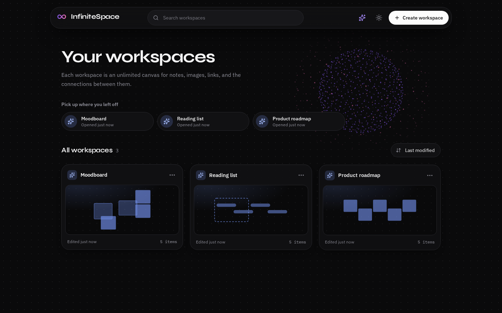 | 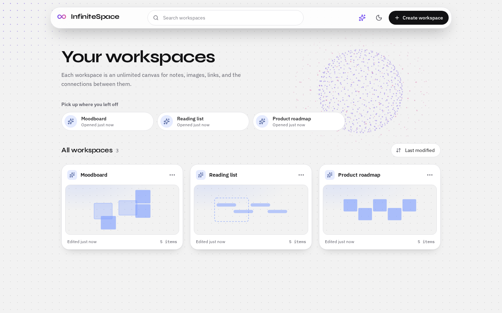 |

| Canvas (dark) | Canvas (light) |
| --- | --- |
| 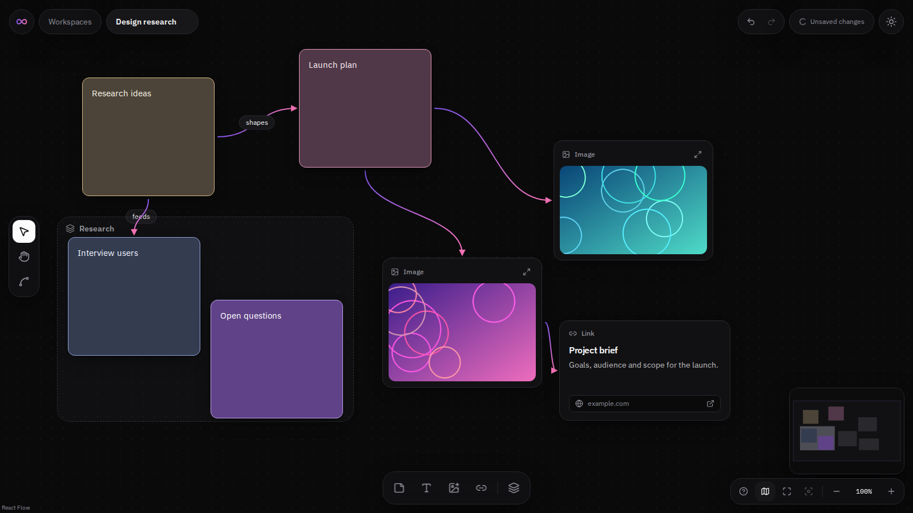 | 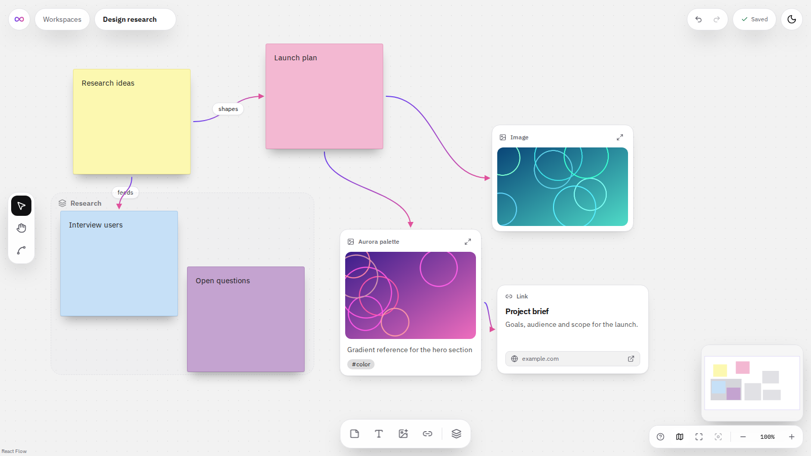 |

| Image properties | Connection properties |
| --- | --- |
| 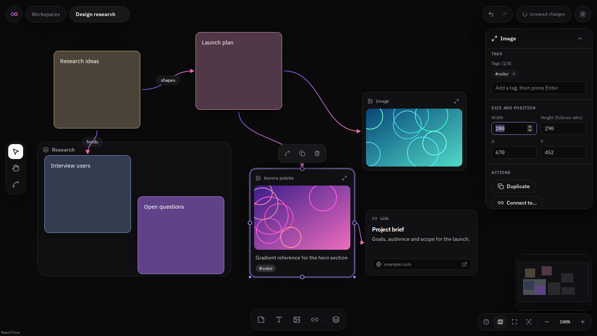 | 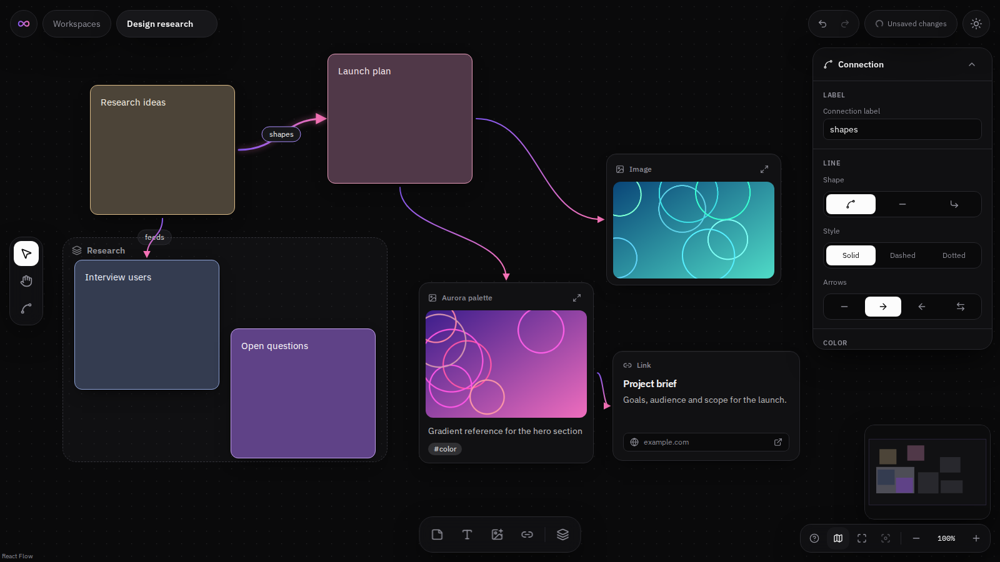 |

| A failed save: the work stays on screen and Retry is offered | Keyboard focus: Tab reaches cards and shows a ring |
| --- | --- |
| 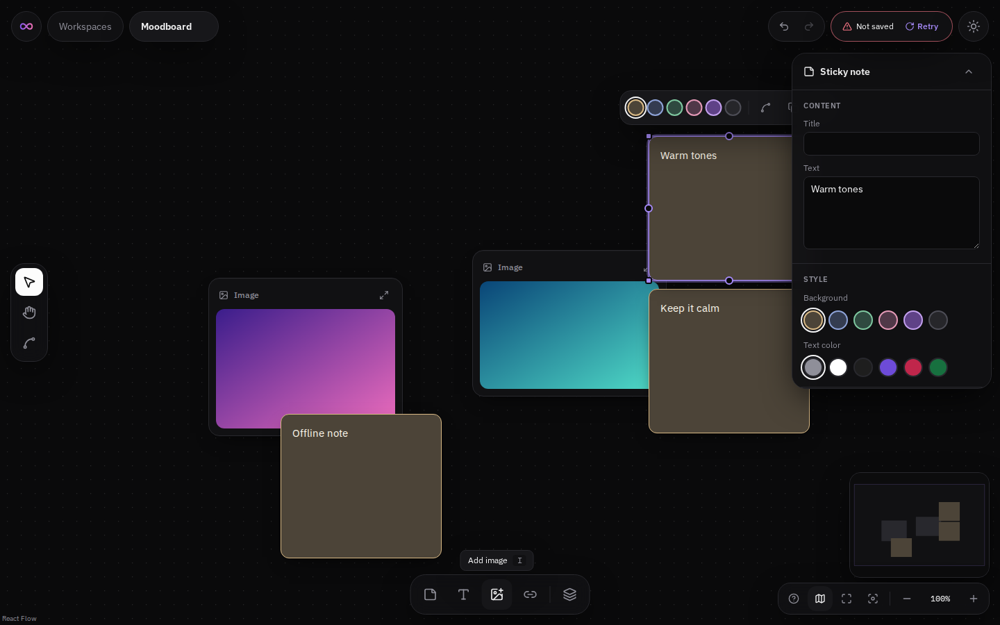 | 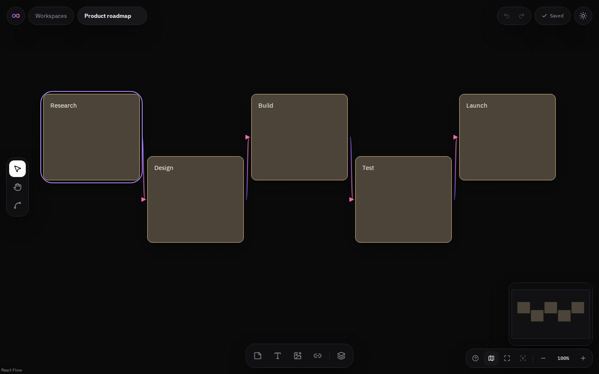 |

| Tablet dashboard (768 px) | Tablet editor (768 px) |
| --- | --- |
| 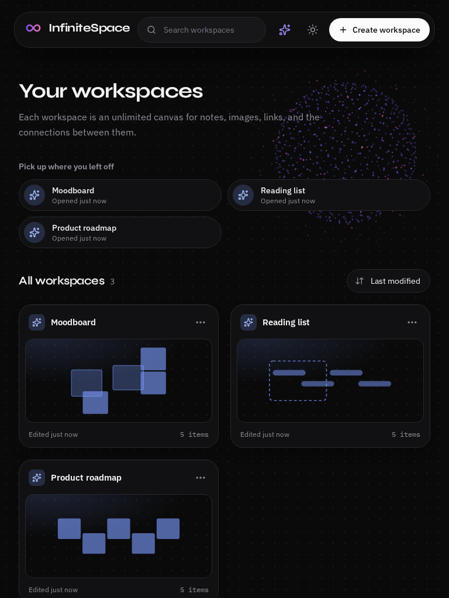 | 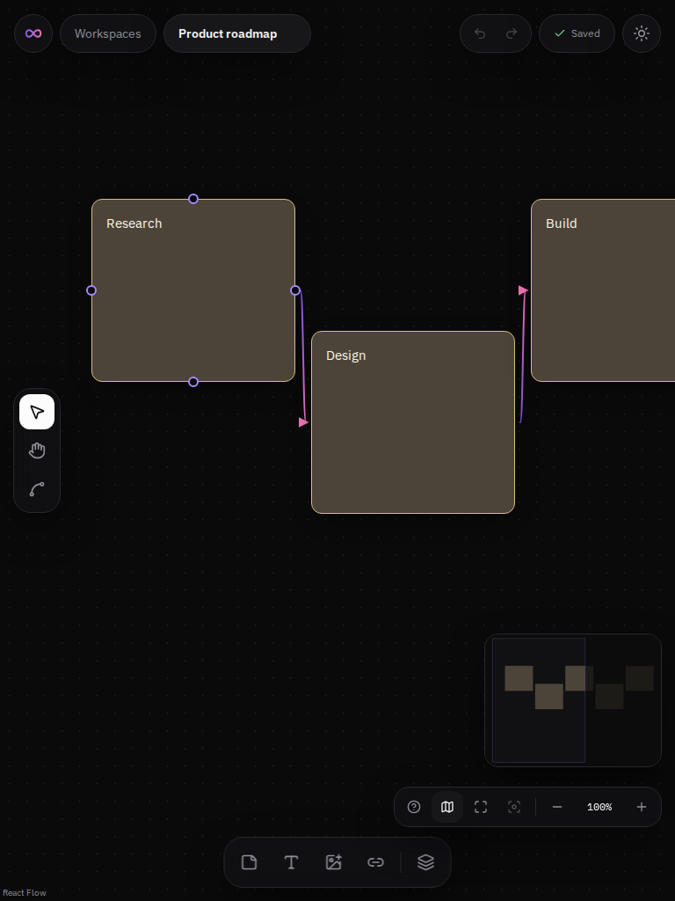 |

| Create workspace | Canvas on a phone | Dashboard on a phone |
| --- | --- | --- |
| 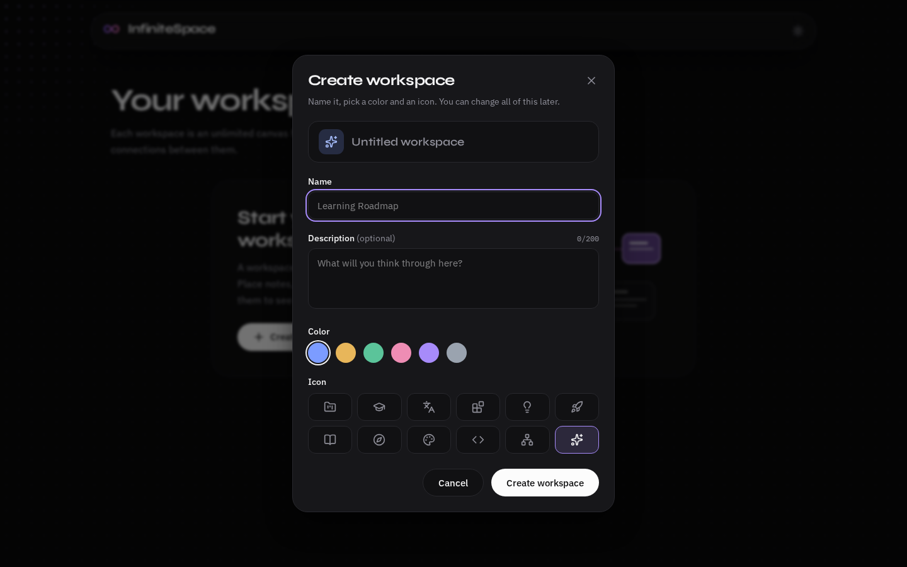 | 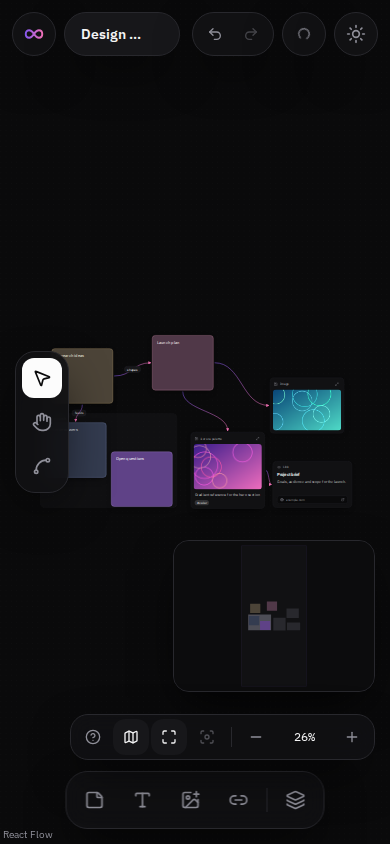 | 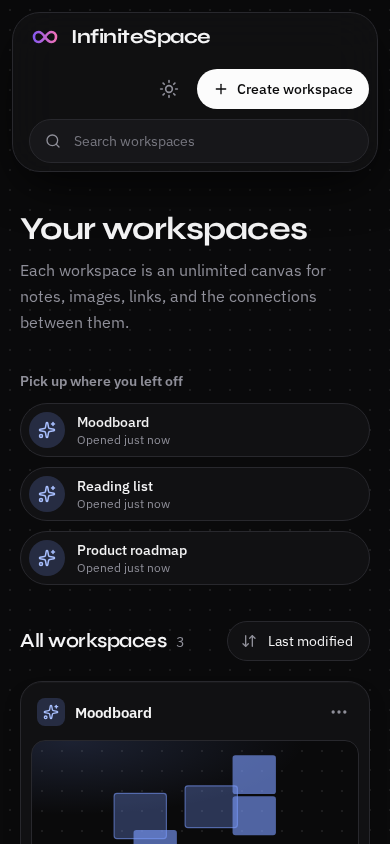 |

## Visual direction

The look follows six reference screenshots supplied for the project: dark whiteboard/canvas tools with floating pill-shaped bars, a left tool rail, a bottom dock, and tinted cards, plus a light sticky-note board.

- **Colors were sampled from the references**, not guessed: a near-black canvas with thin borders in dark mode, a neutral `#F2F2F2` canvas with white panels in light mode, a white (dark mode) / black (light mode) primary action, and a violet accent for selection.
- **Floating chrome:** the editor has no full-width bars. A top row of pills (logo, breadcrumb, save status, theme), a left rail (select, hand, connect), a bottom dock (sticky note, text, image, link, group), a floating properties panel on the right, and a bottom-right cluster (help, minimap, fit, zoom).
- **Sticky notes follow the theme:** tinted dark cards with a light border and white text in dark mode; bright paper-like notes with sharp corners and a paper shadow in light mode.
- **Layout and color values only** were taken as inspiration. No logos, icons, images, or text from the references are used.
- **Connections:** curved arrows with a violet-to-pink gradient along the line, circular handles on the four sides of every card (shown on hover, selection, or while connecting), a dot at the midpoint of a selected connection, and optional dashed or dotted lines and labels.
- **Cards:** image, link, and text cards share a small header (icon and label) like the reference cards; tags appear as `#tag` chips inside the card; groups are dashed translucent frames with a title bar.
- **Motion is restrained and purposeful** (GSAP): the dashboard reveals in sequence, a newly created or duplicated card enters with a short pop, the editor's floating chrome slides in when a workspace opens, and the "Saved" check pops once when a save completes. Nothing animates the canvas itself. All of it is off when the system asks for reduced motion.
- **Two effects adapted from [Magic UI](https://magicui.design) (MIT):** *Magic Card*, a soft spotlight and glowing border that follow the pointer over a workspace card, and *Border Beam*, a light that travels around the border of the one card on the empty dashboard. Both are plain CSS (no animation library), and the spotlight is written to the element directly, without re-rendering React.
- **Optional background effect (Three.js):** a slowly turning sphere of violet and pink dots behind the dashboard heading that leans a little toward the pointer. It is decorative, can be turned off with the sparkle button, and is never used in the editor.
- **Not copied:** the references also show collaboration (avatars, remote cursors, Share), a library search bar, and AI features. None of that is in scope for this project.

## Implementation status

| Phase | Scope | Status |
| --- | --- | --- |
| 1 | Foundation, design tokens, dashboard, workspace creation flow | **Done** |
| 2 | Canvas viewport, node model, sticky notes and text cards, selection, drag, edit, delete | **Done** |
| 3 | Edges (connections), image and link cards, groups, tags, properties panel | **Done** |
| 4 | Undo/redo, full persistence (IndexedDB), viewport restore, populated card previews | **Done** |
| 5 | Magic UI components, GSAP polish, optional Three.js effect, responsive/a11y pass | **Done** |
| 6 | Final verification across themes, devices, and large workspaces | **Done** |

### What works today

**Dashboard (Phase 1)**

- Create a workspace with a name, optional description, color, and icon; rename and customize, duplicate, and delete with confirmation.
- Search (name and description; accent- and case-insensitive; Arabic diacritics ignored) and sort (last modified, date created, name).
- "Pick up where you left off" row, last-modified time and item count on each card.
- Workspaces persist in the browser and sync between tabs.

**Canvas (Phase 2)**

- Pan by dragging the background (or switch to the Hand tool), zoom with the mouse wheel or the buttons, fit all content, zoom to selection, reset to 100%, optional minimap. Pinch-to-zoom comes from React Flow and was not tested on a touch device.
- Sticky notes (6 colors, resizable, title + multi-line text) and text cards. Text is edited directly inside the node.
- Select one or many nodes (`Shift`/`Ctrl`/`⌘` + click, `Shift` + drag box), drag them together, resize, duplicate, delete.
- Add at the pointer with `N`/`T`, double-click the background, or arm a tool from the dock and click (works with touch).
- A floating toolbar above the selection (note colors, duplicate, delete), helpful empty-canvas instructions, and a keyboard shortcuts dialog (`?`).
- Hand tool for pan-only navigation.

**Quality**

- Dark and light themes (remembered, no flash on load), `prefers-reduced-motion` support, keyboard-operable controls, labelled icon buttons.
- The dashboard, and the editor with a selected note and a text card, were audited with axe-core (WCAG 2.0/2.1 A and AA) in both themes with no violations. Dialogs and the empty-state screens were checked manually, not with axe.

**Relationships (Phase 3)**

- **Connections.** Drag from a dot on any side of a card to another card, or use the Connect tool (`C`): click the first card, then the second (works on touch). Any dot connects to any dot. A connection follows its cards when they move and is deleted with them. Rules: no self-connections, no duplicate in the same direction (the reverse is allowed), and groups cannot be connected.
- **Connection properties.** Shape (curved, straight, stepped), line style (solid, dashed, dotted), arrows (none, end, start, both), color (gradient or six solid colors), and an optional label.
- **Images.** Add from the dock or `I`, drag files onto the canvas, or paste from the clipboard. PNG, JPEG, WebP, GIF, and AVIF up to 10 MB and 40 megapixels; up to 12 files at once. Files are stored in IndexedDB. Resizing changes the width and the height follows the original aspect ratio. Double-click opens a large preview. Replace the picture from the properties panel.
- **Links.** A link card holds an address, an optional title, and an optional description, and opens in a new tab. Only `http` and `https` addresses are accepted (`example.com` becomes `https://example.com/`). The app never fetches the page, so there are no automatic previews or favicons.
- **Groups.** A dashed frame with a name and a color. Drop a card so its center is inside the frame to add it; dragging it out releases it. Move the frame by its title bar and its cards move with it. Resizing the frame adds the cards it now covers and releases those it no longer covers. Deleting a frame keeps its cards in place. Duplicating a frame duplicates its cards and the connections between them. Groups cannot be nested.
- **Tags** on any card (up to 8, 24 characters each), shown as chips and edited in the properties panel.
- **Properties panel.** Appears for one selected card or connection (a short summary for several). Edit text, color, tags, size, and style; Duplicate, Connect to…, and Delete. It collapses, and becomes a bottom sheet on phones. Fields apply when you press `Enter` or leave the field, not on every keystroke.

**Saving and history (Phase 4)**

- **Automatic saving.** Every change to cards, connections, groups, images, tags, and the view (pan and zoom) is saved to the browser about 0.8 s after you stop (at most 5 s after the first change). Selecting, hovering, and measuring never trigger a save. Reloading restores the canvas exactly, including the position and zoom.
- **Save status** in the top bar: *Saved*, *Saving…* / *Unsaved changes*, or *Not saved* with a **Retry** button when the browser refuses the write (storage full, blocked, or unavailable). Your work stays on screen while saving fails, and the next edit retries automatically.
- **Leaving safely.** Going back to the dashboard saves immediately. Closing or reloading the tab starts a save at once, and the browser asks for confirmation if changes are still unsaved or a save has failed.
- **Undo and redo** (`Ctrl/⌘+Z`, `Ctrl/⌘+Shift+Z` or `Ctrl+Y`, and buttons in the top bar). Up to 100 steps. A step is one user action: a whole drag, a whole resize, one text edit, a delete together with its connections, a duplicate. Creating a note and typing its first text is one step. Quick repeated nudges with the arrow keys are merged. Selecting and panning are not steps. History lives for the session only: it is empty after a reload.
- **Dashboard cards** show the real item count, a scaled preview of the canvas, and "last modified" (which changes only when the content changes, not when you pan).
- **Duplicating a workspace** copies its canvas, and deleting one removes its canvas.
- **Unused images are cleaned up** once per app start (after 8 s): image files that no saved canvas references and that are older than 24 hours are deleted. Cleanup does nothing if any workspace or canvas cannot be read.
- **Damaged data is handled, not trusted.** Unknown or broken cards and connections are skipped with a message; link addresses are validated again. If a whole saved canvas cannot be understood (for example, written by a newer version), the editor opens empty, explains why, and keeps a backup copy of the original so the next save cannot destroy it. If the canvas cannot be read at all (storage blocked), the editor refuses to open an empty canvas that would overwrite it, and offers *Try again*.

**Polish, effects, and accessibility (Phase 5)**

- **Background effect.** On by default on screens at least 768 px wide; the sparkle button in the dashboard header turns it off or on, and the choice is remembered. It is not created at all when the system asks for reduced motion or the browser reports data saving (the button is then disabled and says why), when WebGL is unavailable, or on phones. It stops drawing while the tab is hidden or the effect is scrolled out of view, uses a capped pixel ratio and the low-power GPU hint, and frees every GPU resource when turned off or when you leave the dashboard. It loads as a separate chunk (about 131 KB gzipped) only when it is needed: opening a workspace directly never downloads it.
- **Magic Card and Border Beam** (see Visual direction). The beam is hidden where the browser lacks `offset-path: rect()`, and with reduced motion.
- **Motion** (GSAP) never leaves inline styles behind and never touches elements that React Flow positions with its own transforms.
- **Keyboard.** The first Tab stop in the editor is a "Skip to canvas" link. Tab reaches cards and connections and shows a focus ring on them; `Enter` or `Space` selects, the arrow keys move a selected card, `Delete` removes it, `Ctrl/⌘+Z` undoes. Screen readers get a description of those keys when a card or connection is focused, and an announcement of each move.
- **Size limit and large canvases (Phase 6).** A workspace holds at most **5,000 items** and 10,000 connections, enforced when you add, duplicate, or connect (you get a message) and again when a saved canvas is read, so nothing can be created that would be silently cut off on the next open. Canvases above 1,500 items start with the minimap hidden, because it draws one rectangle per item and was the largest single cost per frame; the minimap button shows it again.
- **Phones and tablets.** Layout was checked at 390, 768, 1024, and 1440 px: no horizontal scrolling, the toolbars never overlap (below 900 px the zoom cluster and minimap sit above the dock), and the properties panel starts collapsed under 1024 px. On touch screens every ordinary button is at least 44 × 44 px, small buttons (color swatches, tag removal) keep their look but get a 44 px touch area, and the connection dots and resize handles are larger.

### Not implemented yet

Reconnecting an existing connection by dragging its end, restoring undo history after a reload, conflict detection between two tabs, a way to restore the backup copies from the interface, export and import of workspaces (the spec makes it optional), and a larger selection of Magic UI components (only the two above were used, because only these two had a clear job).

### Keyboard shortcuts

| Keys | Action |
| --- | --- |
| `V` / `H` / `C` | Select tool / Hand tool / Connect tool |
| `N` / `T` | New sticky note / text card at the pointer |
| `L` / `G` | New link card / group at the pointer |
| `I` | Add images from your device |
| Drop or paste an image | Add it to the canvas |
| Drag from a card's dot | Connect two cards |
| Double-click background (or inside a group) | New sticky note |
| `F2` | Edit the selected card (not images; use the properties panel) |
| `Esc` | Finish editing, cancel an armed tool, clear selection |
| `Ctrl/⌘ + A` / `Ctrl/⌘ + D` | Select all / duplicate selection |
| `Ctrl/⌘ + Z` | Undo |
| `Ctrl/⌘ + Shift + Z`, `Ctrl + Y` | Redo |
| `Delete` / `Backspace` | Delete selection |
| `Shift` + drag, `Shift`/`Ctrl`/`⌘` + click | Box select, add to selection |
| `+` / `-`, `Shift+1`, `Shift+2` | Zoom, fit all, zoom to selection |
| `Ctrl/⌘ + Enter` | Finish editing text, or save a link card |
| `?` | Show the shortcuts list |

Shortcuts are inactive while typing in a field, while a node is being edited, and while a dialog is open.

## Technology

| Area | Choice |
| --- | --- |
| UI | React 19, React Router 7 |
| Canvas | React Flow (`@xyflow/react` 12) |
| Build | Vite 8, TypeScript 6.0 (strict, `noUncheckedIndexedAccess`) |
| Styling | Tailwind CSS 4 with CSS-variable design tokens |
| State | Zustand 5 |
| Motion | GSAP 3 (dashboard, editor entry, card and save confirmations) |
| Effects | Three.js (optional dashboard background, lazy chunk), CSS effects adapted from Magic UI |
| Icons | Lucide React |
| Fonts | Syne, IBM Plex Sans, IBM Plex Mono, self-hosted via Fontsource (no third-party requests) |
| Tests | Vitest 5 + jsdom |
| Lint | ESLint 10, typescript-eslint, eslint-plugin-react-hooks 7 |

Magic UI components are copied into a project rather than installed as a package; the two used here (Magic Card, Border Beam) are rewritten as plain CSS and a small hook, and credited in the file headers (Magic UI is MIT licensed). The React Flow attribution link is kept visible, as its license asks of non-Pro users.

**Bundle sizes (gzipped, production build):** app shell 158 KB, editor 83 KB (loaded when a workspace opens), Three.js scene 131 KB (loaded only when the dashboard effect runs).

### Version decisions

Versions were rechecked against the npm registry during Phase 6, and every update inside the allowed ranges was applied (`npm update`; `npm audit` reports 0 vulnerabilities). Three packages are deliberately **not** on their newest major:

- **TypeScript 6.0.3 instead of 7.0.2**: the current `typescript-eslint` (8.72) declares support for `typescript <6.1.0`, so TypeScript 7 would break linting.
- **React Router 7.18 instead of 8.5**: v8 requires Node ≥ 22.22, while Vite 8 only needs Node ≥ 20.19.
- **`@types/node` 22 instead of 26**: the types should match the Node version the project targets (22).

## Getting started

**Prerequisites:** Node.js `^20.19.0` or `>=22.12.0`, and npm.

```bash
npm install
npm run dev        # http://localhost:5173
```

No environment variables are required (there is no backend and no secrets), so there is no `.env` file.

### Scripts

| Command | What it does |
| --- | --- |
| `npm run dev` | Start the Vite dev server |
| `npm run build` | Type-check (`tsc -b`) then create the production build in `dist/` |
| `npm run preview` | Serve the production build locally |
| `npm run typecheck` | TypeScript project check |
| `npm run lint` | ESLint |
| `npm test` | Run unit tests once (`npm run test` is the same command) |
| `npm run test:watch` | Run unit tests in watch mode |

## Architecture

```
src/
  app/                    App shell: router, theme sync, 404 page
  components/
    ui/                   Primitives (Button, Dialog, DropdownMenu, Toaster, Logo, ...)
    layout/               Page-level visuals (dot-grid background)
    magic/                BorderBeam (adapted from Magic UI, MIT)
  features/
    workspaces/           Dashboard: cards, form dialog, search/sort, utils (+ tests)
      effects/            Optional Three.js background (lazy), toggle, reduced-motion check (+ tests)
    canvas/               Editor
      components/         CanvasEditor, tool rail, creation dock, zoom controls,
                          selection toolbar, top bar, shortcuts dialog
        nodes/            Sticky, text, image, link, and group nodes, NodeFrame, editors, node-types
        edges/            ConnectionEdge (gradient, arrows, label), edge-types
        properties/       Node and connection property editors, form controls
      hooks/              useCanvasCommands, useCanvasShortcuts, useImagePaste, useImageUrl
      persistence/        Canvas codec (validation), autosave controller, loader, image cleanup, summary
      pages/              WorkspaceEditorPage
      styles/             React Flow theming, node and edge styles
      types/              Node and edge models (discriminated unions)
      uploads/            Image validation, decoding, intake pipeline, object-URL cache (+ tests)
      utils/              Node factory, group rules, connection rules, URL and tag helpers (+ tests)
  stores/                 workspace-store, ui-store, canvas-store, canvas-history (+ context/provider, selectors)
  services/persistence/   StorageAdapter (localStorage metadata + IndexedDB canvases), ImageStorage + IndexedDB with memory fallback (+ tests)
  hooks/                  useNow, useDocumentTitle, useSpotlight (Magic Card)
  lib/                    cn, id, time formatting (+ tests)
  styles/                 Tailwind entry, design tokens, themes
e2e/                      Playwright flow scripts for phases 3, 4, and 5 (Python, run by hand)
```

### Key decisions

- **Replaceable persistence.** All storage goes through the async `StorageAdapter` interface. The app uses a hybrid: small workspace metadata (name, color, item count, preview) in `localStorage` so the dashboard paints instantly, and canvases and images in IndexedDB (asynchronous, far larger than `localStorage`'s 5 MB). If IndexedDB does not exist, canvases fall back to `localStorage`.
- **Serialized, latest-state saves.** Each save reads the store when it runs and saves run one after another, so an older save can never overwrite a newer change. This holds for the workspace list and for canvases.
- **Dirty means content, not state.** The autosave compares only what is persisted (ids, types, positions, sizes, parents, data, connections, viewport) against the last saved snapshot, by reference and in O(n) with no JSON serialization. Selection, dragging flags, and measurements are ignored, and undoing back to the saved state cancels the pending write.
- **Untrusted storage.** Everything read from storage is rebuilt field by field (`canvas-codec.ts`): types, ranges, sizes, colors, handles, parents, and link addresses are validated; damaged entries are skipped and counted; unreadable content is backed up (one stable slot per workspace) before anything can overwrite it.
- **Snapshot history.** Undo/redo stores snapshots of the node and edge arrays. The state is immutable, so a snapshot shares every unchanged node with the live state and costs only a few references. This avoids writing an inverse for every operation (a classic source of bugs). Steps are bounded by explicit transactions (drag, resize) and by merging rules, not by timers alone; a synchronous batch of store changes is one step.
- **Cleanup never guesses.** Deleting an image file is irreversible, so the cleanup only runs when it can read every workspace and canvas, ignores files younger than 24 hours (another tab may be mid-edit, or undo may need them), and never touches a file any saved canvas references.
- **One canvas store per open editor.** Opening another workspace starts from a clean state (no leakage), and the store is testable in isolation. Every node change goes through its actions, which is what makes history and saving observable in one place.
- **Load before editing.** The editor and its store are created only after the saved canvas has been read and validated, so there is no flash of an empty canvas and autosave cannot start before we know what is saved.
- **Typed node model.** `CanvasNode` is a discriminated union (`sticky | text | image | link | group`) on top of React Flow's node type; the node and edge registries are module-level constants so React Flow does not remount them. One generic `updateNodeData(id, type, patch)` action is typed per node type, so a patch for the wrong type does not compile.
- **Rules live in pure functions.** Group membership, connection validity, handle selection, URL and tag normalization, and image validation are plain functions with unit tests; components only call them. All connection paths (dragging, the Connect tool) share one validity check.
- **Group membership by center.** A card belongs to the smallest group that contains its center. It is evaluated when a drag ends, when a card is created, and when a group is resized. Positions of members are relative to the group (React Flow's `parentId`), and groups are kept first in the node array because React Flow requires parents before children.
- **Images are blobs, not strings.** Node data holds only an `imageId`; the bytes live in IndexedDB behind an `ImageStorage` interface. A reference-counted object-URL cache keeps images that scroll out of view cheap to restore and revokes the least recently used ones. If IndexedDB is unavailable, images stay in memory and the user is told once.
- **Height-less image nodes.** Image cards store a width only; CSS `aspect-ratio` derives the height, so resizing can never distort a picture.
- **Deletion is ours.** React Flow's delete key is disabled; one `removeSelection` action deletes selected cards and connections, keeps the cards of a deleted group, and removes dangling connections.
- **Local text drafts.** While editing, text lives in the editor component and is committed to the store once when editing ends. The canvas does not re-render per keystroke, and undo/redo does not record every character.
- **Shared commands.** Buttons, shortcuts, and the empty-state button call the same command functions, so they cannot drift apart.
- **Theme-aware note colors.** Sticky colors are CSS variables per theme (`--sticky-*`), so switching theme needs no extra logic and the minimap and swatches use the same values.
- **Virtualized rendering.** React Flow renders only nodes inside the viewport (`onlyRenderVisibleElements`).
- **Graceful degradation.** If browser storage is blocked, the app works in memory and says so; if it is full, saves report a clear error and the in-memory change is kept.

### A pitfall worth knowing

`cn()` uses `tailwind-merge`, which drops any class starting with `text-` that sits before another `text-*` utility (it assumes a text color). A custom class named `text-card` silently lost its border and background this way. Custom component classes must not start with a Tailwind utility prefix; `src/lib/cn.test.ts` guards this for the existing ones.

## Testing

`npm test` runs 326 unit tests in 26 files covering validation, search and sorting, copy naming, the storage adapters (corruption, backups, quota errors, canvas copy/delete, the hybrid adapter), the workspace store (including dashboard summaries), the node factory, the canvas store (selection, duplication, editing state, connections, groups, size limits, isolation between editors), undo/redo (steps, transactions, merging, limits, restoring groups), the canvas codec with hostile and damaged input, the autosave controller (debounce, maximum wait, failures and retry, stale writes, serialization of writes) under fake timers, the image cleanup safety rules, group and connection rules, URL and tag helpers (including hostile schemes such as `javascript:` and `data:`), image validation and intake, the image storage fallback, the object-URL cache, the saved UI preferences (theme, sort, background effect, with untrusted input), toast behavior, the geometry and smoothing helpers of the Three.js scene, and `cn()`.

The user-facing flows were verified in Chromium against the production build.

- **Phase 3:** [`e2e/phase3_flows.py`](e2e/phase3_flows.py) runs 43 checks: connecting by dragging, with the Connect tool, and with Connect to…, duplicate and invalid connections, editing a connection (dashed, arrows, label, gradient), adding, rejecting, previewing, captioning, replacing, resizing, and deleting images (IndexedDB round trip and aspect ratio), link addresses (normalization, `javascript:` rejection), groups (capture, move, release, delete keeps cards), drag-and-drop and paste of images, deleting and duplicating, light theme, and no console errors. Run it by hand as described at the top of the file.
- **Phase 4:** [`e2e/phase4_persistence.py`](e2e/phase4_persistence.py) runs 43 checks: saving and restoring every kind of card, connection, group membership, image bytes, and the pan/zoom after a reload; undo/redo by keyboard and buttons (a whole drag, a delete with its connection, a group move, creation plus first text, quick arrow-key nudges); the saved state matching the undone state; leaving the editor right after an edit; dashboard counts and previews; duplicating and deleting workspaces; a simulated storage failure with Retry; the leave-confirmation; unreadable and partly damaged saved data (with a `javascript:` link address planted in storage); and the image cleanup (an unused old image removed, a used one kept). It takes about a minute because the cleanup starts 8 s after load.
- **Phase 5:** [`e2e/phase5_polish.py`](e2e/phase5_polish.py) runs 66 checks in four browser contexts (desktop, reduced motion, direct editor load, touch): the Three.js effect (starts with exactly one canvas, takes no pointer input, really paints pixels, turns off and on and remembers the choice, stops drawing while the tab is hidden and resumes, keeps running across a theme switch, is never created or downloaded for the editor), reduced motion (no canvas, disabled toggle, no entrance animation, no beam), Magic Card and Border Beam, GSAP (chrome fades in on entry and leaves no inline styles; the dock stays exactly centered; a duplicated card enters), keyboard use (skip link, reaching and moving a card, the focus indicator of every Tab stop on the dashboard and in the editor), layout at 390, 768, 1024, and 1440 px (no overflow, nothing overlapping, panel inside the screen), 44 px touch targets, and axe-core. Pillow is needed for the pixel comparison, and axe runs only if `AXE_PATH` points at `axe.min.js` (`npm i axe-core` somewhere outside this project).
- **Phase 6:** [`e2e/acceptance.py`](e2e/acceptance.py) walks the specification's Definition of Done as one continuous user journey (25 checks, including the light theme, a phone, and a tablet), and [`e2e/phase6_stress.py`](e2e/phase6_stress.py) is the load test described under Verification. The whole run takes about five minutes, so the stress script can be split with `SIZES`, `SKIP_UPLOADS`, and `ONLY_UPLOADS`.
- **Phases 1 and 2:** earlier Playwright scripts (50 checks for the dashboard, 76 for the canvas) were run at the time but **are not in this repository**.
- **Accessibility:** axe-core (WCAG 2.0/2.1 A and AA) reported no violations in seven Phase 3 states (link editor open, connection selected, image selected, image preview dialog, group selected, in both themes) six Phase 4 states (saved, save error with Retry in both themes, undo enabled, and a populated dashboard card in both themes), and Phase 5 states (the dashboard with the effect in both themes, and the editor with the properties panel open at four widths). Automated checks find only part of the possible problems; the keyboard checks above are automated, but nobody has used the app with a screen reader, so announcements (the save status, card moves) are untested in practice.
- There is **no automated browser test in CI** yet. It is on the roadmap.

## Security considerations

- No backend, no network requests from application code, no external fonts or scripts.
- No `dangerouslySetInnerHTML`; user text is rendered through React's escaping. Workspace names and descriptions are normalized (control characters removed, whitespace collapsed) and length-limited on input and again on load. Node titles and text are length-limited by the input fields.
- **Links:** only `http` and `https` are accepted; `javascript:`, `data:`, `file:`, `blob:`, `ftp:`, `mailto:` and addresses with embedded credentials are rejected. The address is validated again when a link card is rendered, and the anchor uses `target="_blank"` with `rel="noopener noreferrer"`. The app makes no request to the address.
- **Images:** the type is checked against an allow-list (SVG is excluded because it can carry scripts), the size is capped at 10 MB, the decoded pixel count at 40 megapixels, and a file that cannot be decoded is rejected. Images are shown through `blob:` URLs created from the stored bytes. Decoding happens in the browser, so a very large but valid image can still take a moment.
- **Saved data is untrusted.** Anything read back from the browser's storage is validated and rebuilt (see Key decisions), so editing the stored data by hand, or data from another version, cannot inject a `javascript:` link, a malformed card, or an oversized value into the app. The backup copy of unreadable data is stored as is and is never executed or rendered.
- `index.html` contains a small inline script that applies the saved theme before first paint. If you deploy behind a strict Content-Security-Policy, allow it with a hash or nonce.
- `npm audit` reported 0 vulnerabilities.
- Workspaces are stored **only in this browser** and do not sync between devices or browsers.

## Deployment

The build output in `dist/` is a static single-page app. Configure the host to serve `index.html` for unknown paths (a rewrite to `/index.html`), otherwise opening `/w/<id>` directly or refreshing on it returns a 404.

## Known limitations

- **Everything is local to one browser profile.** Clearing site data, using another browser or device, or private windows that discard storage removes it. There is no export or import yet.
- **Two tabs on the same workspace**: the last tab to save wins; there is no conflict detection or live sync. Undo history is per tab and not restored after a reload.
- **Saving during tab close is best effort.** Browsers do not guarantee that an asynchronous write finishes while a page is closing. The app starts the write immediately and asks for confirmation when changes are pending, but a crash or a forced close can lose the last fraction of a second of work.
- **Undoing the deletion of an image card** works while the image file still exists. The cleanup keeps unused files for 24 hours, so undo works across a long session but an image removed and left unused for more than a day cannot be restored by an old tab; the card then shows "Image unavailable".
- If IndexedDB is blocked, images are kept in memory only (and are lost when the tab closes), and canvases fall back to `localStorage` (about 5 MB). The app tells you once when images fall back.
- Backup copies of unreadable data are kept in IndexedDB but there is no screen to restore them; recovering one needs the browser developer tools.
- The storage quota is not measured or shown; you learn it is full when a save fails.
- Groups cannot be nested, cannot be connected, and an overlapped card joins a group only if its center is inside. Resizing a group re-evaluates every card on the canvas.
- Connections cannot be re-attached by dragging their ends; delete and create again. Two connections between the same pair in opposite directions overlap when both use the default sides.
- Link cards show only what you type: no page title, description, or icon is fetched.
- **A workspace holds at most 5,000 items and 10,000 connections** (see Verification). Zoomed all the way out with thousands of cards visible, panning is noticeably slower; there is no level-of-detail mode.
- Nodes lag the pointer by up to the 3 px drag threshold at the start of a drag (an intentional guard against accidental drags).
- Double-click creation needs a mouse or a double-tap; use the dock tool, then tap the canvas, on touch devices.
- Two tabs editing at once follow "last writer wins" at the workspace-list level.
- No Arabic web font is bundled; Arabic text renders in the system font (it displays correctly and right-to-left inside nodes and inputs). The interface itself is English-only and left-to-right.
- Only Chromium was used for automated browser verification; Safari, Firefox, and real devices were not tested. Touch behavior was checked with Chromium's device emulation (coarse pointer, touch taps), not on a real phone or tablet; the phone layout of the properties panel was checked only by geometry and screenshots.
- **The background effect was only run in headless Chromium with software WebGL.** Frame rate, battery use, and look on real GPUs, Safari, Firefox, and low-end devices were not measured. If it feels heavy on your machine, turn it off with the sparkle button.
- **Border Beam** needs `offset-path: rect()`. It is hidden where that is unsupported, but only Chromium was checked.
- No screen reader was used. The app provides labels, descriptions, live regions, and keyboard paths, and automated checks pass, but real announcements are unverified.

## Verification

Phase 6 ran the application against the specification's Definition of Done, then against large workspaces and many large images. Everything below was run on the production build in headless Chromium inside a sandbox with software rendering and no GPU; absolute numbers will be better on a real machine, and each figure is a single run, so expect noise (for example, the 3,000-item row's save and undo times are higher than the 4,940-item row's). What matters is the shape: costs grow roughly linearly with the item count and nothing collapses.

### Definition of Done

| # | The user can… | Evidence |
| --- | --- | --- |
| 1 | Open the dashboard | `e2e/acceptance.py` |
| 2 | Create and name a personal workspace | `e2e/acceptance.py` |
| 3 | Open that workspace | `e2e/acceptance.py` |
| 4 | Navigate an effectively unlimited canvas | Zoom out and pan until a card sits ~9,800 canvas px from the origin, then fit-all brings it back (no pan limit is configured beyond a sanity clamp of ±10,000,000 px when reading saved data; zoom is 0.1× to 3×) |
| 5 | Add, edit, move, resize, duplicate, and delete sticky notes | `e2e/acceptance.py` |
| 6 | Upload and position images | `e2e/acceptance.py`; 12 large images at once in the load test |
| 7 | Create text and link cards | `e2e/acceptance.py` |
| 8 | Connect nodes with lines and arrows | `e2e/acceptance.py` |
| 9 | Organize content into groups | `e2e/acceptance.py` |
| 10 | Undo and redo important operations | `e2e/acceptance.py`, `e2e/phase4_persistence.py` |
| 11 | Save changes automatically | `e2e/acceptance.py`, `e2e/phase4_persistence.py` |
| 12 | Refresh and recover the workspace | Cards, connections, image, pan and zoom, and the dashboard count after a reload |
| 13 | Switch between dark and light themes | Switch, survive a refresh, edit and save in light |
| 14 | Use it on desktop and smaller screens | 390 px phone and 768 px tablet journeys; layout also checked at 1024 and 1440 px (`e2e/phase5_polish.py`) |
| 15 | Export or back up workspace data *if an export feature is implemented* | **Not applicable: no export feature exists.** Data lives only in this browser. |

### Load test

Generated canvases were written straight into IndexedDB (so reading and validating them is part of the test), mixing notes, text, links, images, groups, and connections. "DOM cards" is how many cards exist in the page at normal zoom, and at "fit all" (everything on screen, the worst case). Frame times are the 95th percentile (p95) of a synthetic pan with the mouse; at 60 fps a frame is 16.7 ms.

| Items | Connections | Open | DOM cards (normal / fit all) | Pan p95 | Drag p95 | Pan p95 at fit all | Save | Undo | JS heap |
| ---: | ---: | ---: | ---: | ---: | ---: | ---: | ---: | ---: | ---: |
| 55 | 39 | 0.4 s | 20 / 55 | 33 ms | 67 ms | 67 ms | 0.8 s | 0.05 s | 22 MB |
| 505 | 433 | 0.9 s | 20 / 505 | 33 ms | 67 ms | 100 ms | 0.2 s | 0.2 s | 40 MB |
| 1,515 | 1,317 | 1.9 s | 20 / 1,479 | 50 ms | 67 ms | 350 ms | 1.1 s | 0.6 s | 132 MB |
| 3,035 | 2,653 | 2.8 s | 20 / 1,836 | 33 ms | 33 ms | 150 ms | 3.3 s | 2.9 s | 84 MB |
| 5,000 (the limit) | 4,387 | 4.3 s | 20 / 1,954 | 50 ms | 67 ms | 450 ms | n/a | 1.2 s | 120 MB |

- **Only visible cards are rendered**, so normal panning and dragging stay near the display's frame time even at 5,000 items. Zoomed all the way out with thousands of cards on screen, every card is in the page and panning is slower (up to a few hundred ms per frame here). That is the known weak spot; there is no level-of-detail mode.
- **The minimap was the biggest per-frame cost** (10,000 items: pan average 198 ms with it, 90 ms without), which is why it starts hidden above 1,500 items.
- **Why the limit is 5,000.** A canvas of 10,000 items was also tried: it opened in about 7 to 15 s and panned at roughly 200 ms per frame here, so the limit was set at the largest size that stayed comfortable instead of allowing it. At the limit, the 5,001st card is refused with a message (checked).
- **A real bug found by this test and fixed:** the previous limit applied only when reading a canvas, so a canvas could grow past it and silently lose items on the next open. The limit is now enforced at creation as well. The test also led to replacing a quadratic scan in the undo history with a linear one.
- **Uploads.** Twelve images of about 2.4 MB each were added in 1.5 s, all decoded, and all survived a reload. A file over 10 MB, an image over 40 megapixels (7000×6000), a thirteenth and fourteenth file, a text file, and a corrupt `.png` were each refused with a readable message and without breaking the canvas.

### What was not verified

Safari, Firefox, real GPUs, real touch hardware, real screen readers, long-running sessions (memory over hours), two tabs on the same workspace, and browsers with IndexedDB blocked (the fallback code is unit-tested, not exercised in a browser). Nothing here is a substitute for using the app on your own devices.

## Roadmap

1. **Beyond the spec, by priority:** export and import of a workspace (the safety net that data kept only in one browser needs, and Definition of Done item 15), conflict detection between tabs, a screen to restore backups, and a level-of-detail mode for very zoomed-out canvases.
2. **Tooling:** port the Playwright flows to `@playwright/test` and run lint, tests, build, and the flows in CI.
